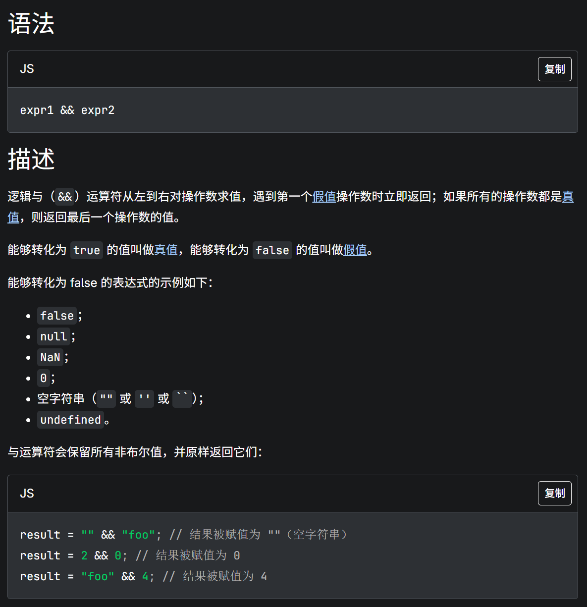

最近学习JS出现了这一个语句：
```js
{readingList.map((book) => <li>{book.title}{book.note && <span>--{book.note}</span>}</li>)}
```
值得注意的是这里的`book.note`是字符串，如果字符串为空那这里的内容就为空，但字符串不一定为空。假如字符串为`stringExample`，那么此表达式可以看作：
```
'stringExample' && '--stringExample'
```
理论来说，我们没办法知道它的值，直觉上讲，它的值应该是`1`。但实际测试上显示的是`--stringExample`。
## 运算符原理
好的，实际上JavaScript的与运算符原理是这么规定的：



简单来讲，表达式`A&&B`可以看成如下的`if-else`语句：
```
if(A)
  B
else
  A
```