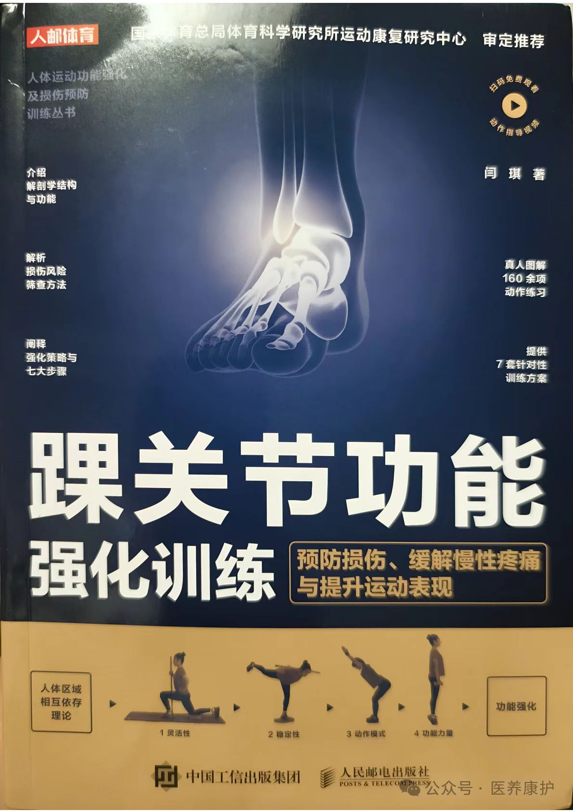

> 这里贴了几篇原文：
>
> 1. [根据脚踝疼痛位置，判断脚踝具体问题（第一部分）](https://mp.weixin.qq.com/s/Xch7y1LRRFf3LOsakhMWoA)
>
> 2. [根据脚踝疼痛位置，判断脚踝具体问题（第二部分）​](https://mp.weixin.qq.com/s/emwgRqQgAWKToBIFhM2ldw)
> 
> 3. [崴脚后的恢复训练](https://mp.weixin.qq.com/s/XNAzJQ4GzPnFkQo3zr4new)
>
> 4. [踝关节不稳定的强化训练](https://mp.weixin.qq.com/s/ZT62j_jeVuOaY0qxzT2iTQ)
>
> 5. [足部+脚踝功能强化（第二部分）](https://mp.weixin.qq.com/s/3EX_d2HjsQYy4VGQ7eRjjA)
>
> 6. [改善扁平足，需要整合足与髋](https://mp.weixin.qq.com/s/sNNvxPXI7kEtAJD8vIp_NQ)

另外更详细的内容可以参考教科书：



可以通过下方的网盘链接获取：

```
通过百度网盘分享的文件：48.踝关节功能....pdf
链接：https://pan.baidu.com/s/1CWmvSrVttFISW12jIU7-Eg 
提取码：sULf 
复制这段内容打开「百度网盘APP 即可获取」
```