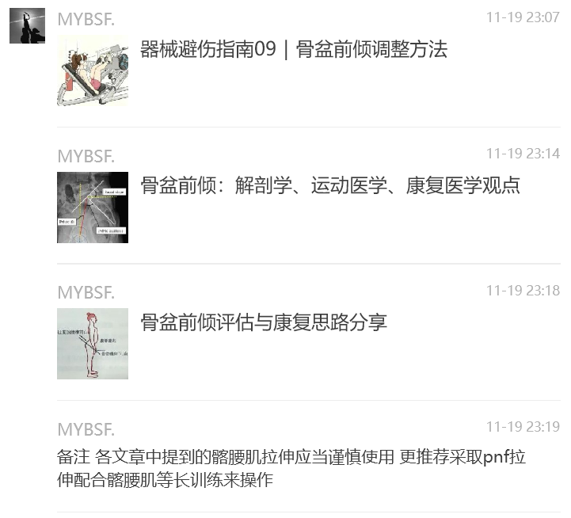

[器械避伤指南09｜骨盆前倾调整方法](https://mp.weixin.qq.com/s/gSmOU7Vgy-4-PHdtljUt3A)

[骨盆前倾：解剖学、运动医学、康复医学观点
](https://mp.weixin.qq.com/s/Pd6zmueB6rXnG6O_7UWdTQ)

[骨盆前倾评估与康复思路分享](https://mp.weixin.qq.com/s/3j-e5UVBsENx3TTRRhdB1A)

